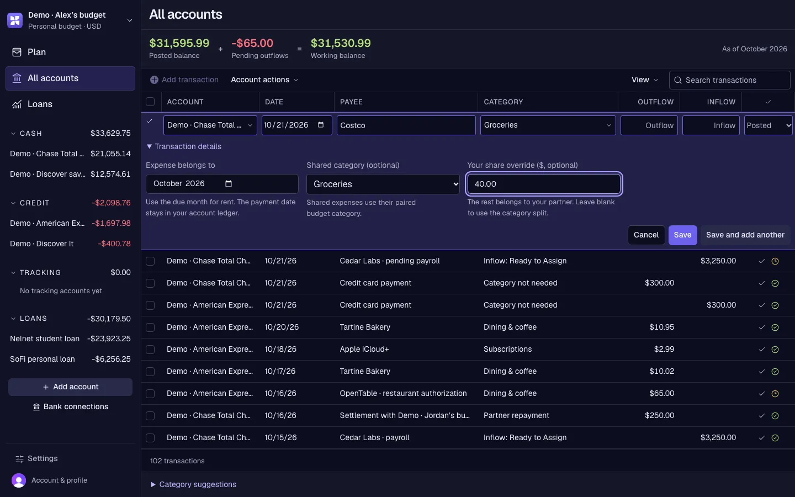

# Transaction details (retired)

The legacy app's transaction editor had a collapsible **Transaction details** section under the main row (account, date, payee, category, outflow, inflow, status). It was dropped when the legacy app was retired, and the owner plans to redesign shared-expense transactions later. This page keeps what it did so that redesign can start from it. The engine still supports every field below; only this editor went away.

## Fields

### Expense belongs to (expense month)

A month picker, defaulting to the month being viewed (or the transaction's saved value). It sets the transaction's **expense period** (`expenseMonth`), the month the expense counts toward in personal spending reports and the shared settlement report, independently of the payment date. Hint: "Use the due month for rent. The payment date stays in your account ledger." Left blank, the engine uses the transaction date's month. The editor rejected anything that wasn't a valid `YYYY-MM`.

### Shared category (optional)

Shown only when the household has shared categories. A select of the household's shared categories plus "Personal expense". Choosing one:

- made the purchase a **shared expense** under that shared category (`sharedCategoryId`), split between the partners by the category's rule;
- switched the transaction's category to the user's own budget category paired with that shared category, and limited the category picker to it. Hint: "Shared expenses use their paired budget category";
- cleared any share override.

Rules the editor enforced:

- An existing shared expense couldn't be made personal here ("Personal expense" was disabled when editing one).
- A shared expense couldn't be turned into a transfer ("Resolve the shared expense before converting it to a transfer.").
- Only categories the user participates in were valid, and the transaction's category had to be the paired one.
- Inflows (merchant refunds) on a shared category were refused: "Shared merchant refunds need manual investigation in this version."
- "Inflow: Ready to Assign" wasn't offered for a shared expense.

The current shell editor has no such control. It keeps an existing `sharedCategoryId` when editing but can't make a new purchase shared.

### Your share override ($, optional)

Shown once a shared category is chosen. Placeholder: "Use the category split". Leave it blank and the purchase is split by the shared category's weights. Enter an amount and that becomes the user's **personal share**, with the rest of the outflow going to the partner (`shares: { [me]: ownShare, [partner]: outflow - ownShare }`). The purchase keeps that split even if the category's rule changes later. When editing, the hint showed the original share ("Original share $X. Leave blank to keep the original split."). Otherwise: "The rest belongs to your partner. Leave blank to use the category split."

Validation: a nonnegative amount with at most two decimals, no more than the full outflow, only with a shared category chosen, and only when the household has exactly one connected partner.

### Posted / Pending (bank status)

A select at the end of the main row (not inside the details section, but part of the same set of fields), defaulting to Posted. It set `status`:

- **Posted**: confirmed activity. It counts toward the account's cleared balance, can be reconciled, and is required for loan payments ("Loan payments require confirmed posted activity").
- **Pending**: authorized but not yet cleared. Pending outflows reduce the working balance and category availability right away. Pending inflows are ignored until they post, and nothing pending counts toward the cleared balance or reconciliation. The register header showed "Posted balance + Pending outflows = Working balance".

Bank imports normally set the status. Moving a reviewed pending import to posted keeps its review.

## Where it lived

- `src/components/transactions/transaction-editor.tsx`: the details section and the status select.
- `src/components/transactions/transaction-draft.ts`: draft defaults, validation messages, and how the draft became a `transaction.upsert` command (`status`, `expenseMonth`, `sharedCategoryId`, `shares`).
- Engine fields: `transaction.upsert` / `transaction.save` in `src/domain/engine.ts`. Expense month feeds `src/domain/spending.ts` and the shared ledger in `src/domain/shared-ledger.ts`.
